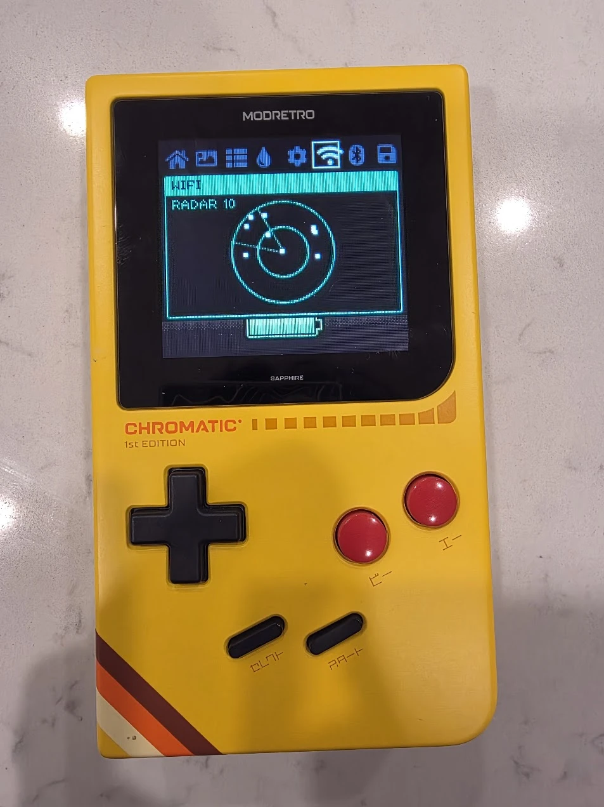
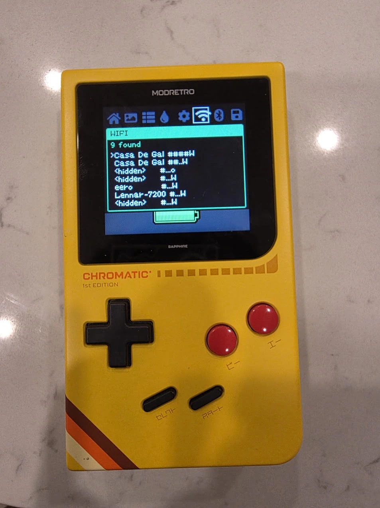
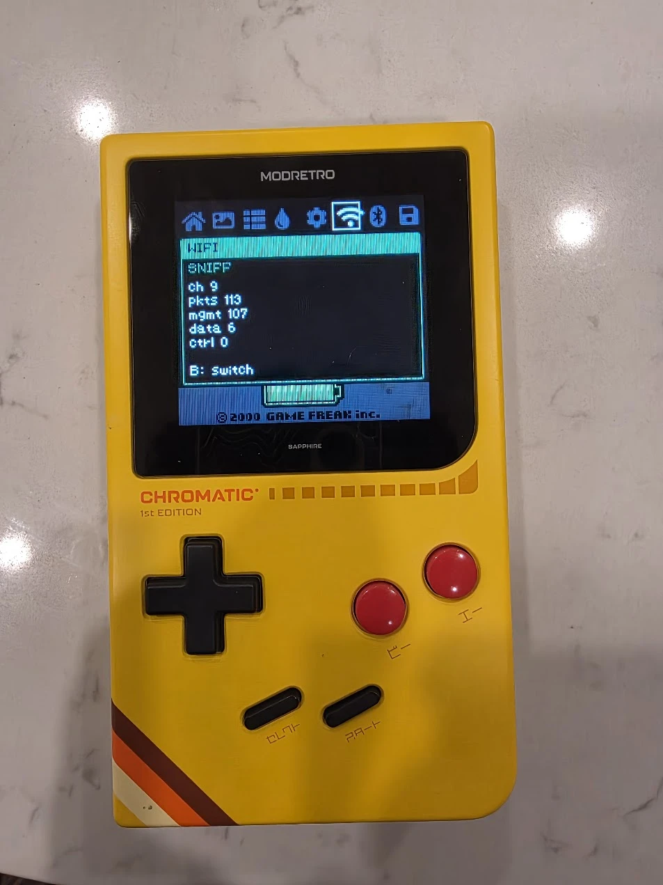
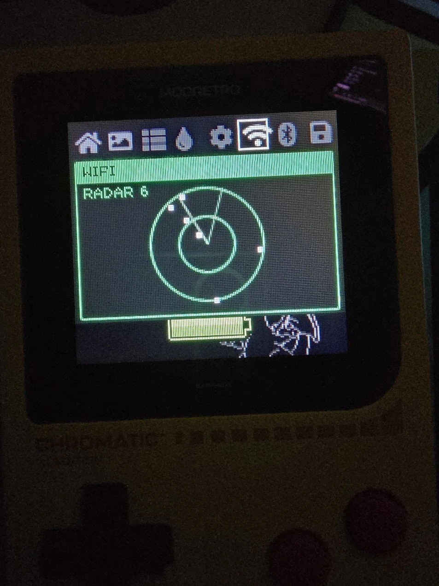
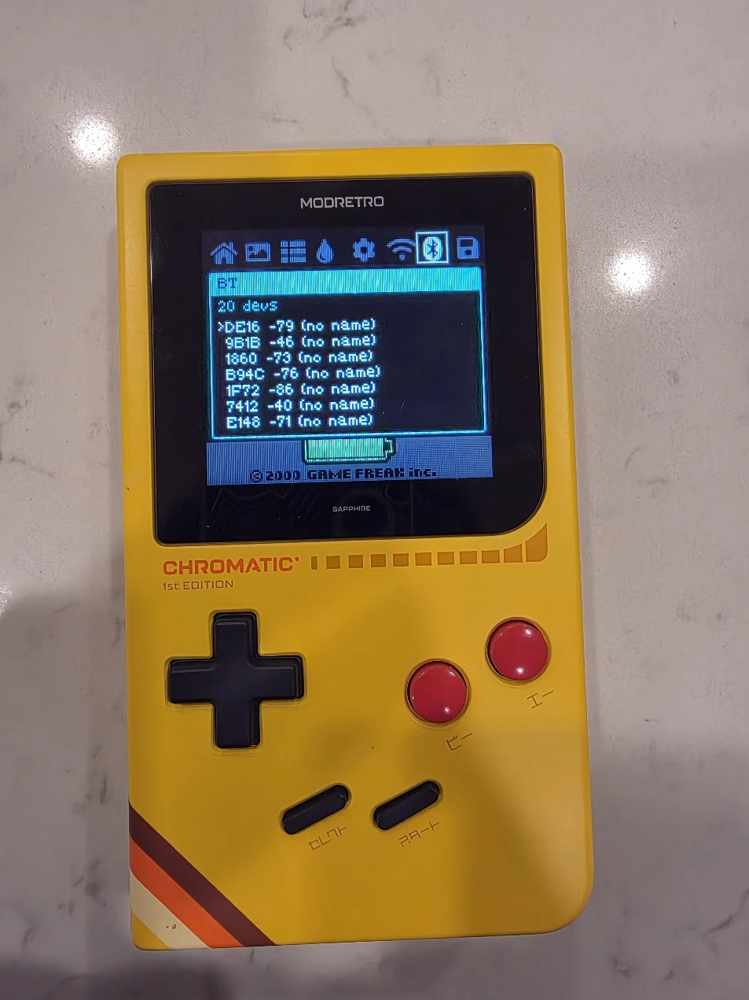
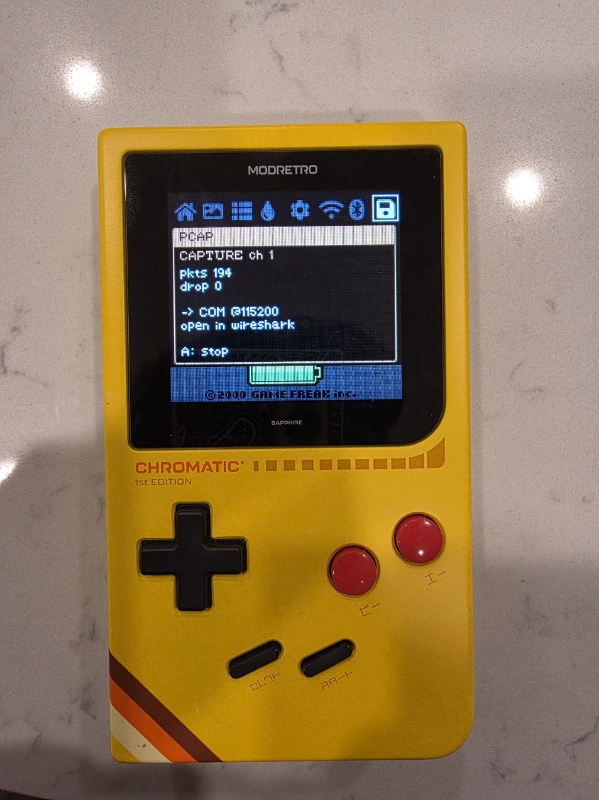
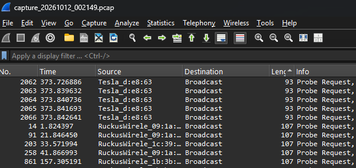

# Chromatic Recon

Turn the **ModRetro Chromatic** into a retro-styled Wi‑Fi / Bluetooth **recon
handheld** — while it still plays Game Boy cartridges exactly as before.

<p align="center">
  
</p>

This is a custom firmware for the Chromatic's onboard **ESP32‑MINI‑1** that adds
three new tabs to the console's menu:

| Tab | Modes | What it does |
|-----|-------|--------------|
| **WiFi** | Scan / Sniff / Radar | Lists nearby access points (SSID, signal, security); passive monitor‑mode frame counters (mgmt/data/ctrl), channel‑hopping; a sweeping radar that plots APs by signal strength |
| **BT** | Scan / Sniff | Lists nearby BLE devices (address, RSSI, name); advertisement‑PDU counters |
| **PCAP** | Capture | Streams a live `.pcap` out the USB serial for **Wireshark** |

The FPGA (which actually runs the Game Boy core) is **never touched** — games,
video, audio and cartridge compatibility are unchanged. Everything here runs on
the ESP32 that draws the console's on‑screen menu.

---

## ⚠️ Authorized use only — please read

This is a **passive, receive‑only** tool for **learning and for assessing
networks and devices you own or have explicit permission to test.**

- It **scans, sniffs and captures** — it does **not** attack. There is
  deliberately **no** deauth/disassoc flooding, no beacon/SSID spam, no
  evil‑portal / credential capture, and no handshake‑cracking tooling.
- Capturing or monitoring traffic on networks you don't own or aren't
  authorized to test may be **illegal** where you live. You are responsible for
  complying with all applicable laws and regulations.
- Provided **as‑is, with no warranty**. Flashing custom firmware is at your own
  risk. **Back up your stock firmware first** (see below).

This project is an **unofficial community project** and is **not affiliated with,
endorsed by, or supported by ModRetro or Nintendo.**

---

## On the Chromatic

All of this runs on real hardware. (The Pokémon splash peeking under some of the
overlays is a cartridge running — the tools don't interrupt games.)

### WiFi — Scan · Sniff · Radar

| Scan | Sniff | Radar |
|:----:|:-----:|:-----:|
|  |  |  |
| Access-point list with signal bars + security | Monitor-mode frame counters (mgmt / data / ctrl) | APs plotted by signal strength, with a sweeping line |

### BT — BLE scan

<p align="center">
  
</p>

Nearby BLE devices with address + RSSI.

### PCAP — live Wireshark capture

| On the Chromatic | …opened in Wireshark |
|:----------------:|:--------------------:|
|  |  |
| Streams a `.pcap` out the USB serial | The captured file in Wireshark — real 802.11 probe requests |

---

## How it works

- The **FPGA** (a Gowin GW5A running the open‑source Game Boy *MiSTer* core) plays
  the cartridge and drives the screen. We don't modify it.
- The **ESP32‑MINI‑1** is the console's MCU. Its stock firmware already draws the
  LVGL on‑screen menu and talks to the FPGA. We **fork that firmware** and add
  our tabs as new menu entries.
- Each tab brings its radio stack up **only on demand** (press **A**) and tears
  it down when you switch sub‑mode or leave the tab — so Wi‑Fi and Bluetooth are
  never resident at the same time (important on this RAM‑limited, non‑PSRAM
  ESP32).

## Controls

- **◀ / ▶** — move between menu tabs (a code‑drawn tab strip shows all tabs).
- Inside a tool tab: **A** = start the selected tool, **B** = switch sub‑mode
  (and stop whatever was running), **Up/Down** = scroll a list / pick a channel.

---

## Build

Requires **Espressif ESP‑IDF v5.3** (see `UPSTREAM.md` for ModRetro's toolchain
notes). Target chip is the classic **esp32**.

```bash
# one-time: install + source ESP-IDF 5.3
idf.py set-target esp32
idf.py build
idf.py size          # sanity-check it fits (BT + WiFi + LVGL is tight)
```

The project ships a custom `partitions.csv` (3 MB app partition — the stock
1 MB is too small once the Bluetooth stack is included) and a tuned
`sdkconfig.defaults` (RAM reductions for Wi‑Fi + BLE coexistence).

## Back up your stock firmware FIRST

Before flashing anything, dump the stock 4 MB image so you can always restore:

```bash
esptool.py -p <PORT> -b 460800 read_flash 0x0 0x400000 chromatic_stock_4MB.bin
```

Keep that file safe. To restore the console to stock:

```bash
esptool.py -p <PORT> write_flash 0x0 chromatic_stock_4MB.bin
```

(ModRetro's own Update Tool is a second recovery path, since the FPGA stays stock.)

## Flash

The Chromatic enumerates as a USB serial port (e.g. `COM10` on Windows,
`/dev/ttyACM0` on Linux). Power the console **on** so the tool can see it.

```bash
idf.py -p <PORT> -b 115200 flash
```

> **Tip:** flashing at 460800 can intermittently drop ("chip stopped
> responding"). **115200** has been rock‑solid here.

If you ever see a **white screen** after flashing, do a full **battery power
cycle** (power switch off ~5 s, cartridge inserted, back on) — that's an
ESP32↔FPGA re‑sync quirk from being reset repeatedly while tethered, not a bad
flash.

---

## PCAP → Wireshark

The **PCAP** tab streams a standard libpcap byte stream (linktype
`LINKTYPE_IEEE802_11`) out the USB serial.

1. On the Chromatic: open the **PCAP** tab, pick a channel (**Up/Down**), press
   **A** to start. `pkts` should climb.
2. On your PC, from `tools/`:
   - **Windows:** double‑click `capture_pcap.bat` (defaults to `COM10`, writes a
     timestamped `.pcap` next to the script, auto‑installs `pyserial`).
   - **Any OS:**
     ```bash
     pip install pyserial
     python pcap_receiver.py <PORT> capture.pcap
     ```
3. Ctrl‑C to stop, then open the `.pcap` in **Wireshark**.

The receiver opens the port with **DTR/RTS deasserted** on purpose — those lines
are wired to the ESP32's reset/boot pins on this board, so a normal serial open
would reset/halt the console.

> Throughput is capped by the serial link, so on a busy channel some frames are
> dropped (`drop` counter). Good for inspecting *what's* talking; not a
> line‑rate capture.

---

## Repo layout

```
components/netscan/        Wi-Fi scan + monitor-mode sniff engine
components/blescan/        passive BLE observer (NimBLE)
components/pcap/           monitor-mode capture -> pcap-over-UART
components/osd/wifi/       WiFi tab UI
components/osd/bt/         BT tab UI
components/osd/pcap/       PCAP tab UI
components/menu_mgr/       (forked) adds the dynamic tab strip
components/osd/osd_default.c  (forked) registers the new tabs
main/                      (forked) heap-allocates the framebuffer
partitions.csv             3 MB app partition
tools/                     PC-side PCAP receiver (pcap_receiver.py, capture_pcap.bat)
rom/                       Stage-1 Game Boy ROM mock-up of the scanner UI (GBDK-2020)
CHANGES.md                 what this fork changes vs. upstream
UPSTREAM.md                ModRetro's original README (toolchain setup)
```

## Credits & license

Built on the shoulders of:

- **ModRetro** — [oss‑chromatic‑console‑mcu](https://github.com/ModRetro/oss-chromatic-console-mcu)
  and [oss‑chromatic‑console‑fpga](https://github.com/ModRetro/oss-chromatic-console-fpga)
- **Game Boy MiSTer** core · **Espressif ESP‑IDF / NimBLE** · **LVGL**

This firmware is a derivative work of ModRetro's GPL‑3.0 firmware and is released
under the **GNU General Public License v3.0** (see `LICENSE`). See `CHANGES.md`
for the list of modifications. Nintendo®, Game Boy® and related marks are
trademarks of Nintendo; this project is not affiliated with Nintendo or ModRetro.
